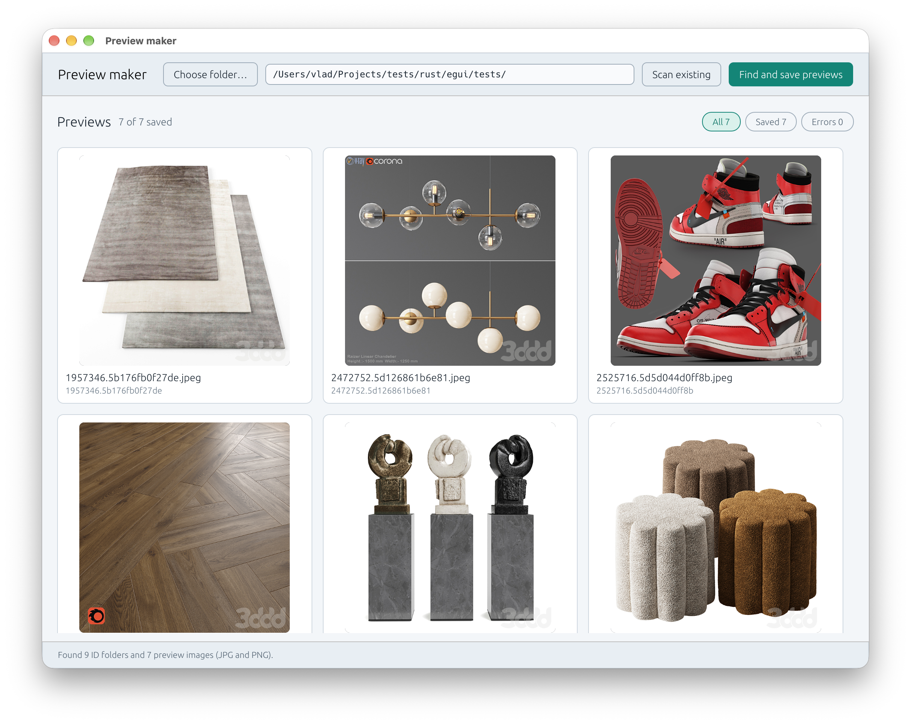

# Preview Maker

Preview Maker helps organize a local library of 3D models downloaded from sites such as [3ddd.ru](https://3ddd.ru/) and [3dsky.org](https://3dsky.org/).

Model archives often have opaque names and no preview image. With tight project deadlines, manually opening every archive or searching the website takes time. Preview Maker scans a model library, retrieves previews, and shows the available models in one grid. You can review the options with colleagues or clients and decide together which models fit a scene.



## Features

- Fetch model titles and preview images from 3DDD or 3DSKY.
- Save each preview inside its model folder.
- Scan a library for existing JPG, JPEG, and PNG images and view them in a grid.
- Filter results by all, saved, or failed previews, and retry failed requests.
- Choose a library folder with the system folder picker or drag it onto the app window.

## Use

1. Download and open Preview Maker from [GitHub Releases](https://github.com/Pha-Ngan-Tribe/preview-maker/releases/latest).
2. Choose the folder that contains your model folders.
3. Select **3DDD** or **3DSKY** in the top bar.
4. Click **Find and save previews** to fetch and save previews, or **Scan existing** to display images already in the library.

The online scan looks for immediate subfolders whose names follow the `<number>.<hexadecimal-id>` format, for example:

```text
My library/
└── 1957346.5b176fb0f27de/
    ├── downloaded-model.zip
    └── preview.jpg
```

The existing-image scan searches through nested folders and supports JPG, JPEG, and PNG files.

Model titles appear in the grid; archive files are not renamed.

## Downloads

GitHub Releases provide:

- **Windows 10/11 x64** — standalone `.exe`.
- **macOS Apple Silicon** — `.zip` containing the app.
- **macOS Intel** — `.zip` containing the app.

The macOS app is not notarized, so macOS may show a security warning when you first open it.

## Build from source

Install the stable Rust toolchain, then run:

```sh
cargo run
```

For an optimized build:

```sh
cargo run --release
```

The theme can be selected for a run with `-light`, `-dark`, or `-system`:

```sh
cargo run -- -light
```

## License

Preview Maker is licensed under [GNU AGPL-3.0-only](LICENSE).
